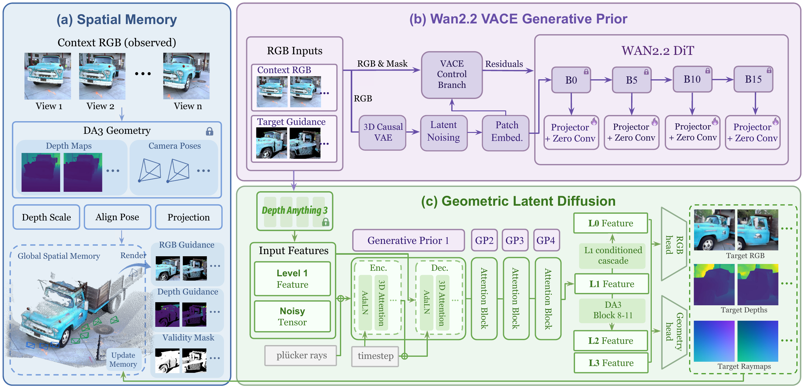

# GeoVerse: World-Consistent Novel View Synthesis in Geometric Latent Space

[Kerui Ren](https://scholar.google.com/citations?user=5kW5apkAAAAJ), [Tao Lu](https://scholar.google.com/citations?user=Ch28NiIAAAAJ), [Linning Xu](https://eveneveno.github.io/lnxu/), [Changjian Jiang](https://scholar.google.com/citations?user=V4miywEAAAAJ), Hunag Mu, Chunhua Shen, [Mulin Yu†](https://scholar.google.com/citations?user=w0Od3hQAAAAJ), [Bo Dai†](https://daibo.info/)

† Corresponding authors.

## Overview

GeoVerse synthesizes world-consistent novel views from sparse images by combining geometric latent diffusion with video generative priors and persistent spatial memory. Training on 15 real and synthetic multi-view datasets improves cross-domain generalization, while reflow distillation enables generation in four denoising updates.

**Pipeline of GeoVerse.** Context observations initialize a global spatial memory that provides target-aligned RGB-D hints. Guided by the hints and Wan2.2 VACE features injected through a ControlNet-style adapter, geometric latent diffusion synthesizes target views in four denoising updates. The decoded RGB and geometry update the memory for subsequent view expansion.

See the [project page](https://geoverse-nvs.github.io/) for the [demo](https://geoverse-nvs.github.io/#demo), [qualitative comparisons](https://geoverse-nvs.github.io/#results), and [citation](https://geoverse-nvs.github.io/#citation).
